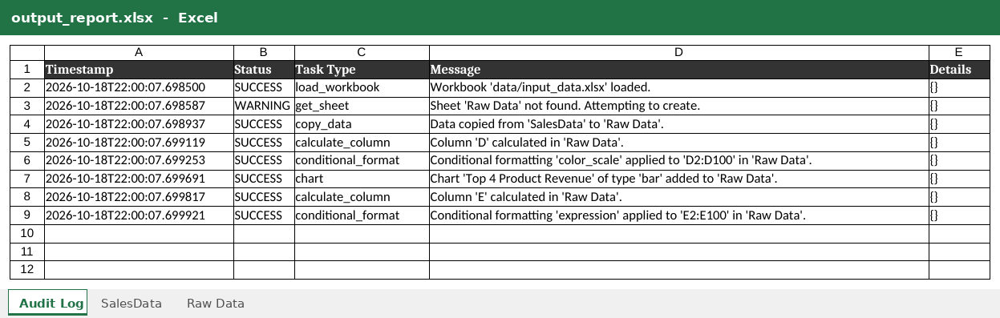
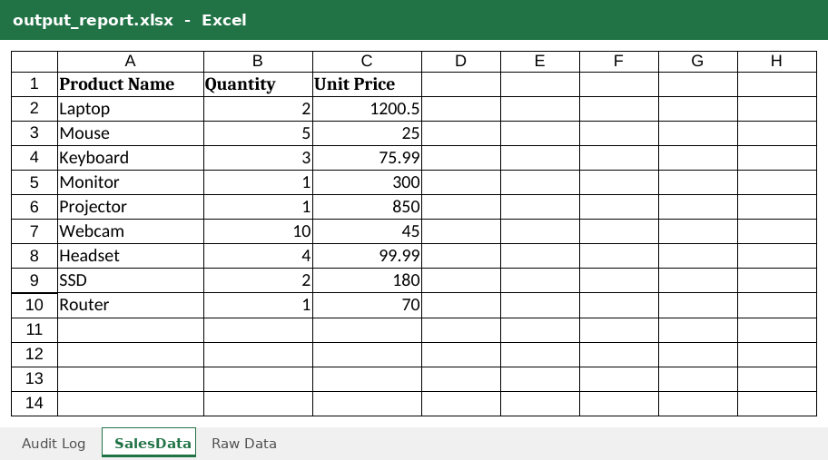
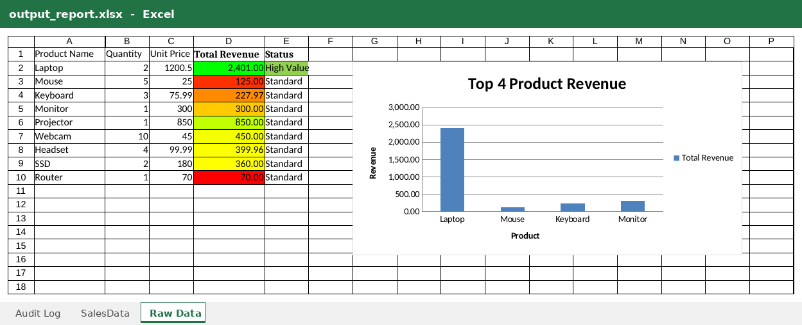

# Week10_LabX ADV_663380372-6
## Advanced Spreadsheet Automation & Agentic Workflows

ผู้จัดทำ: เมธาวี สิทธิชัยเนตร, รหัสนักศึกษา 663380372-6

**Agentic Spreadsheet Processor** อ่านลำดับงานจาก `configs/example_spreadsheet_config.json` แล้วจัดการไฟล์ Excel ด้วย `openpyxl` ได้แก่ copy ข้อมูล, ใส่สูตร, ทำ conditional formatting และสร้างกราฟ จากนั้นบันทึกเป็น `data/output_report.xlsx` พร้อมชีต **Audit Log** ที่บันทึกผลทุกขั้นตอน

## 📸 Screenshots: `data/output_report.xlsx`

### ชีต Audit Log


### ชีต SalesData


### ชีต Raw Data
คอลัมน์ D เป็นสูตร `=B*C` ระบายสีด้วย color scale คอลัมน์ E เป็นสูตร `IF` ถ้าเป็น "High Value" จะไฮไลต์สีเขียว และมีกราฟแท่ง Top 4 Product Revenue


## Tasks (ตาม config)
| # | Task | รายละเอียด |
|---|---|---|
| 1 | `copy_data` | คัดลอก `SalesData` ไปเป็นชีต `Raw Data` |
| 2 | `calculate_column` | D = Total Revenue (`=B{row}*C{row}`, รูปแบบ `#,##0.00`) |
| 3 | `conditional_format` | color scale แดง → เหลือง → เขียว ที่ `D2:D100` |
| 4 | `chart` | Bar chart "Top 4 Product Revenue" วางที่ G2 |
| 5 | `calculate_column` | E = Status (`=IF(D>1000,"High Value","Standard")`) |
| 6 | `conditional_format` | expression `$E2="High Value"` เติมพื้นสีเขียว |
| - | Audit Log | สร้างชีต "Audit Log" เป็นชีตแรก บันทึก timestamp, status, task type และ message |

## วิธีรัน
```bash
python -m venv venv
venv\Scripts\activate            # macOS/Linux: source venv/bin/activate
pip install -r requirements.txt
python create_input_data.py      # สร้าง data/input_data.xlsx (ชีต SalesData), มีให้แล้วใน repo
python main.py
```
ผลลัพธ์: `data/output_report.xlsx` มี 3 ชีต คือ Audit Log, SalesData และ Raw Data

## Project Structure
```
Week10_LabX ADV_663380372-6/
├── src/
│   ├── __init__.py
│   ├── spreadsheet_agent.py      # Agent: dispatch tasks, จัดการ Excel, audit log
│   ├── config_parser.py          # โหลดและ validate config
│   ├── utils.py                  # logging helpers
│   └── google_sheets_utils.py    # placeholder สำหรับ Google Sheets API
├── configs/
│   └── example_spreadsheet_config.json
├── data/
│   ├── input_data.xlsx
│   └── output_report.xlsx
├── screenshots/
│   ├── output_report_Audit_Log.png
│   ├── output_report_SalesData.png
│   └── output_report_Raw_Data.png
├── create_input_data.py
├── main.py
├── requirements.txt
├── .gitignore
└── README.md
```

## สิ่งที่แก้จาก starter code (เดิมโค้ดรันไม่ผ่าน)
1. **`main.py`**: `from .src.utils import ...` เป็น relative import ในสคริปต์หลัก ทำให้เกิด `ImportError` จึงเปลี่ยนเป็น `from src.utils import ...` และเพิ่ม `os.chdir` ไปที่โฟลเดอร์โปรเจกต์ เพื่อให้ path `data/...` ใน config ใช้ได้เสมอ
2. **`spreadsheet_agent.py`**: ใช้ `json.dumps` ในชีต Audit Log แต่ไม่ได้ `import json` จึงเพิ่ม import
3. **`config_parser.py`**: บังคับให้ทุก task ต้องมี `sheet` แต่ task `copy_data` ใช้ `source_sheet`/`dest_sheet` ทำให้ config ไม่ผ่าน validation จึงยกเว้นให้ `copy_data`
4. **`spreadsheet_agent.py` (expression rule)**: `conditional_formatting.add(range, ruleType=..., formula=..., dxf=...)` ไม่ใช่ signature ของ openpyxl จึงเปลี่ยนไปสร้าง `Rule(type='expression', ...)` และตัด `=` นำหน้าสูตรออก
5. **config `category_range`**: `A1:A5` รวมหัวตารางเข้ามา ทำให้ชื่อสินค้าใต้แท่งกราฟเลื่อนไป 1 ตำแหน่ง จึงเปลี่ยนเป็น `A2:A5`
6. **`utils.py`**: `logger.propagate = False` เพื่อไม่ให้ log ทุกบรรทัดแสดงซ้ำสองครั้ง
